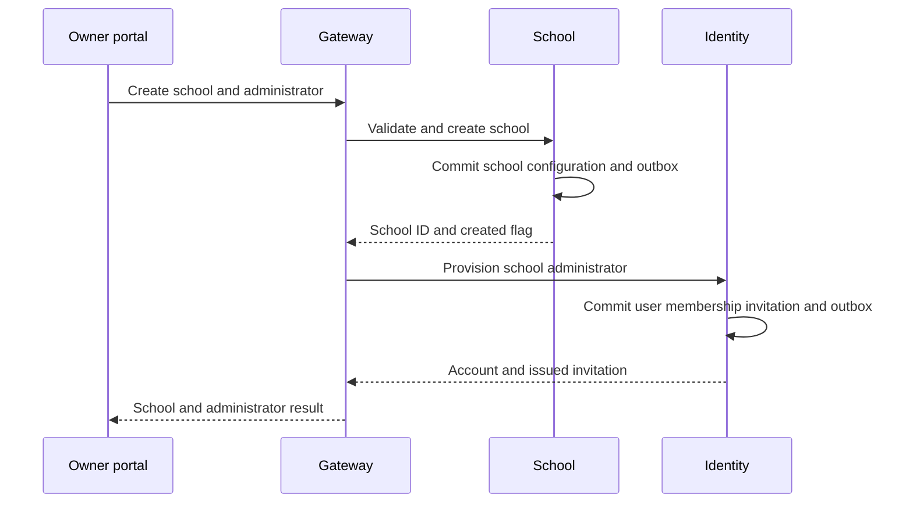
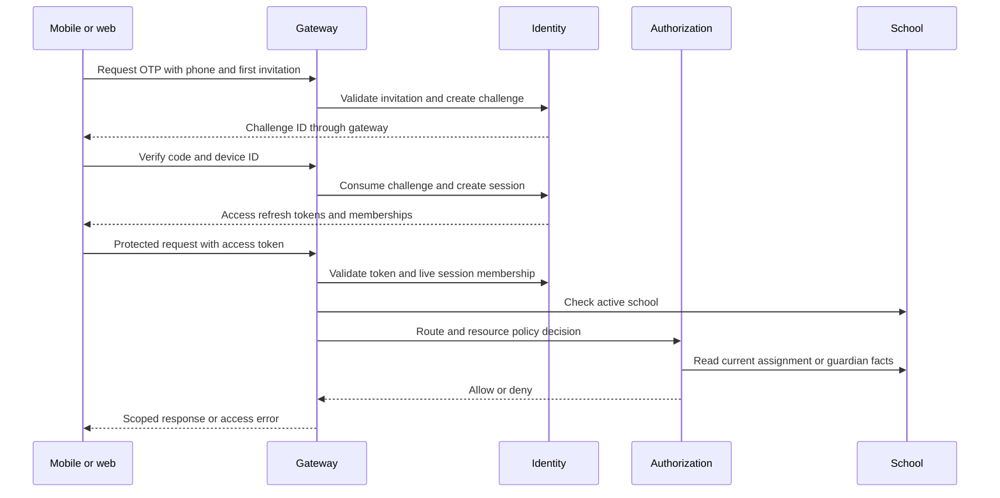
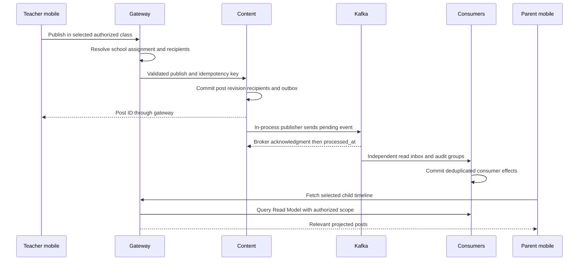
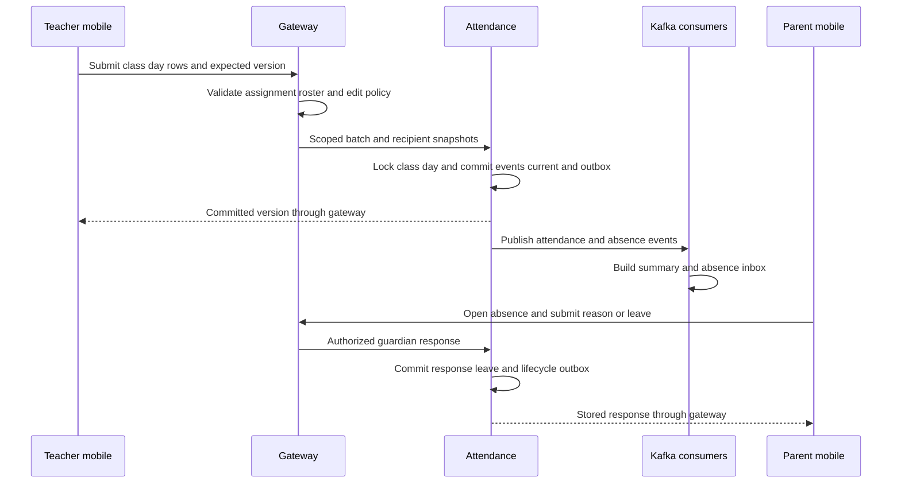
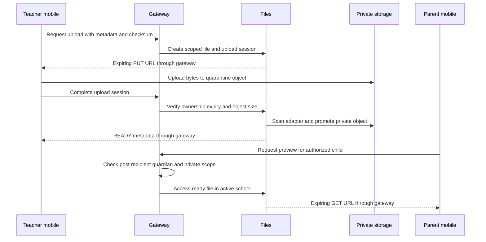
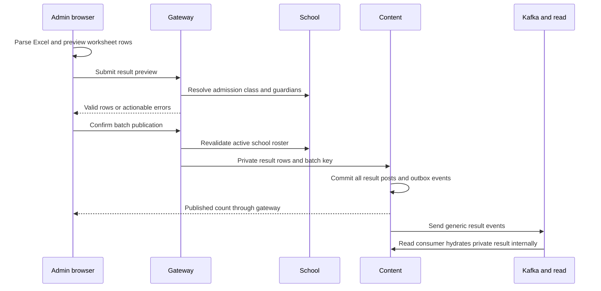
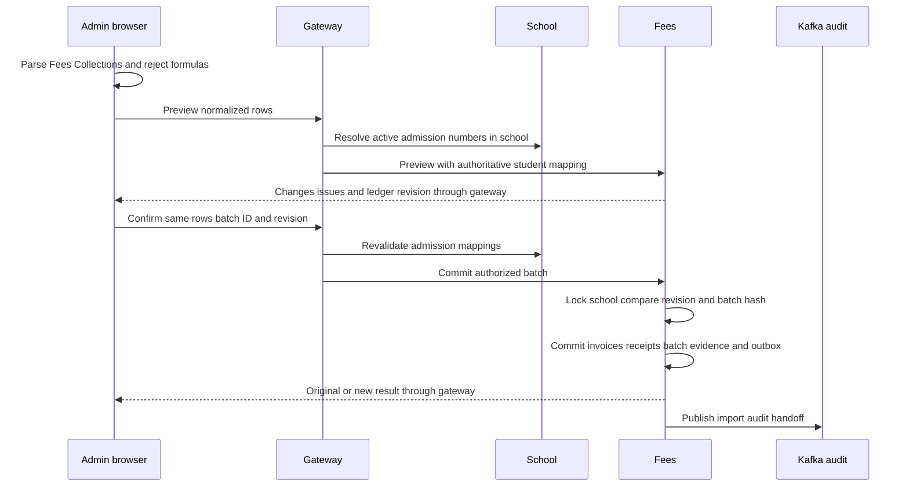
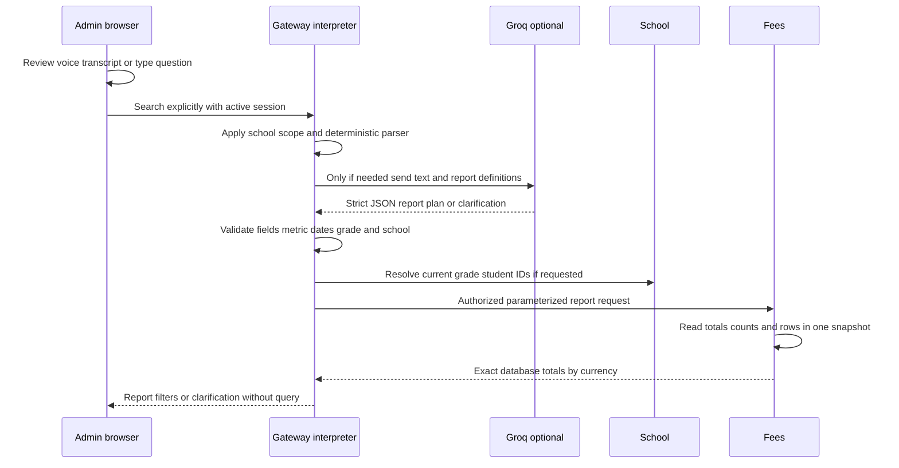
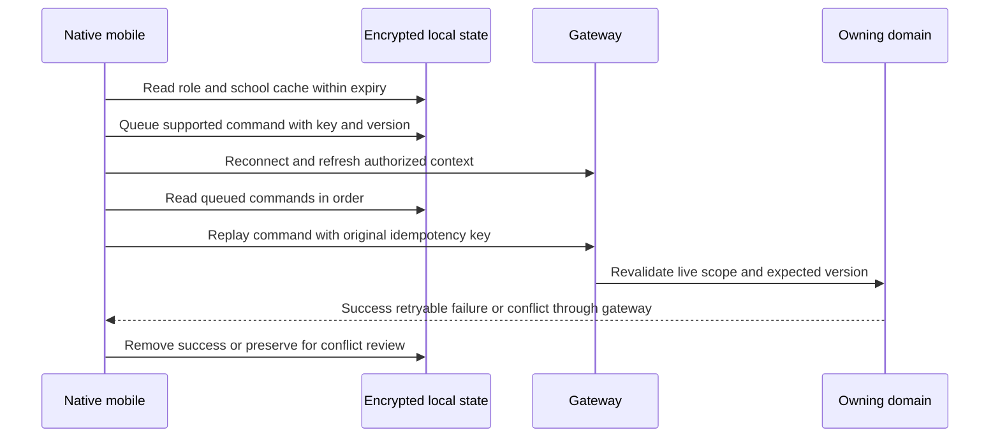

# Nexqon School App Technical Architecture and Database Reference

Version 1.0 | 13 October 2026 | Engineering and operations reference

## 1 Scope and evidence

This document describes the implementation at repository commit `b2cff964877f8603e0eb7258214ad52ab762b461`, with documentation updates dated 13 October 2026. The product is branded Nexqon School App; source packages, database names, event topics and deep links still use the earlier SchoolConnect name. Names in this document match the code rather than introducing a second system.

We have one role-aware mobile codebase for teachers and parents and an approved web portal for platform owners and school administrators. The gateway coordinates ten internal services. Nine services own databases; Authorization has no database. PostgreSQL migrations and repository SQL, not the original proposed technology list, define the implemented data model. Prisma is not the current persistence layer.

The document distinguishes implemented code, configured trial behavior, mocked integrations and production work. A successful unit test is not evidence of production capacity or device delivery. Live Groq planning checks were completed on 13 October; their report contained no matching fees. No database changes, release, GitHub push or deployment are part of this documentation update.

## 2 Product surfaces and technology choices

| Layer | Implemented technology | Why it is used |
| --- | --- | --- |
| Mobile | React Native 0.86.3, Expo 57.0.23, React 19.2.3, TypeScript | One Android and iOS source tree with native device integrations and role-aware views |
| Web administration | React 19.2.3, Vite 8.3.3, TypeScript, SheetJS 0.20.3 | Browser administration and local Excel parsing with preview before submission |
| Public and internal APIs | Node.js 22 in Docker, NestJS 12.0.3, TypeScript, Express | Explicit service modules, controllers and replaceable adapters |
| Persistence | PostgreSQL 17 in the Render manifest, node-postgres pools, parameterized SQL and SQL migrations | Service-owned relational integrity, transactions and exact monetary amounts |
| Events | Kafka, KafkaJS, shared eventing package | Durable asynchronous fan-out to independent consumers |
| Files | AWS SDK S3 client and presigned URLs | Private S3-compatible abstraction rather than public permanent attachment URLs |
| Identity | Local HS256 JWT adapter, SHA-256 token hashes and database sessions | Short access tokens and revocable rotating refresh sessions |
| Mobile storage | Expo SecureStore and encrypted offline persistence | Protect session material and isolate cached role and school contexts |
| Fee interpretation | Rules first; optional Groq structured output or self-hosted Ollama | Convert supported questions to validated filters, without model-generated SQL |
| Verification | Vitest, Supertest, ESLint, TypeScript, Docker integration scripts | Component, controller, contract and actual database workflow checks |
| Workspace | pnpm 10.15.1 monorepo | Shared contracts and event client code with separate application and service packages |

These are package-manifest versions at the documented commit, not a recommendation to upgrade or a promise that upstream versions will remain unchanged. Mobile and web use TypeScript 6.0.3; the gateway package uses TypeScript 5.9.2. Workspace build includes an Expo web export, which is not an Android or iOS release build.

## 3 Logical architecture and physical deployment

Clients call the public gateway under `/api/v1`; they do not call PostgreSQL, Kafka or internal service ports. The gateway has no business database. It verifies session context through Identity, checks active school status, asks Authorization for route decisions and invokes the owning services. Cross-service references are UUIDs, not database joins.

| Service | Default local port | Owned database | Main responsibility |
| --- | --- | --- | --- |
| Gateway | 3000 | None | Public routes, authentication guards, tenant context and orchestration |
| Identity | 3101 | schoolconnect_identity | Users, invitations, memberships and sessions |
| School | 3102 | schoolconnect_school | School structure, enrollment and live relationship facts |
| Content | 3103 | schoolconnect_content | Posts, revisions, recipients, drafts and results |
| Attendance | 3104 | schoolconnect_attendance | Versioned attendance and guardian responses |
| Files | 3105 | schoolconnect_files | Upload metadata, object storage and access evidence |
| Notifications | 3106 | schoolconnect_notifications | In-app inbox, read state and notification events |
| Audit | 3107 | schoolconnect_audit | Cross-service business event audit view |
| Authorization | 3108 | None | Configurable route and resource policy decisions |
| Read Model | 3109 | schoolconnect_read | Event-built post feeds and attendance summaries |
| Fees | 3110 | schoolconnect_fees | Invoice ledger, receipts, imports and authoritative reports |

Internal HTTP calls use `/internal/v1`, a shared internal service token and correlation headers. The gateway's service URLs are environment configuration. Its service-call timeout is five seconds. Services default to loopback binding for local use; container deployment changes the bind host as needed. Independent containers require private networking and least-privilege credentials, not public exposure of internal ports.

The current free Render layout is a deliberate trial compromise. A static portal is deployed separately, but `start-render-demo.mjs` imports all ten services and the gateway into one Node process/container. The nine PostgreSQL databases are separate logical databases on a shared server. Aiven supplies the remotely configured Kafka connection. Separate data ownership does not provide independent CPU, memory, restarts, scaling or failure isolation in this bundled trial.

The manifest sets development mode and mock OTP, keeps internal listeners on loopback and caps each database pool at two connections. Nine pools can therefore use up to eighteen pooled connections, with migration connections temporarily additional. The runtime heap cap is 384 MB. These settings must not be copied as a production capacity plan.

Recommended production separation is one runtime per service with restricted database accounts, managed backups, transport security, real identity verification and monitored Kafka. That is an operational target, not a completed deployment. The application remains synchronously dependent on Identity, Authorization and School for protected requests; loose coupling does not mean services have no dependencies.

## 4 Authentication and authorization

Identity is the authority for account, session and membership state. The JWT contains user, membership and session identifiers with issuer, audience and expiry checks. The implemented adapter is `local-jwt`; the provider interface is replaceable, but another identity provider is not implemented merely because a configuration field exists.

Access tokens default to ten minutes. Refresh tokens are random opaque values stored as hashes, rotated transactionally and tied to the device ID. Reusing an old refresh token or an invalid device binding revokes the session/token family. Logout revokes the session and refresh family. Identity checks live session, user and membership status when the gateway obtains context; School checks the school is active. Role switching selects an existing active membership and returns a new access token.

The current context query accepts a still-valid token for any active membership of that session; it does not require its membership to equal the session's latest active membership. Switching roles therefore does not immediately invalidate the previous role's access token. Existing permissions are still required, but exclusive active-role semantics would need an additional server check if required by policy.

Authorization has route rules selected by method and path, and resource actions for teacher-class and guardian-child access. Default route matching is first-match, with no matching rule denied. `AUTHORIZATION_ROUTE_RULES_JSON` and `AUTHORIZATION_RESOURCE_ROLES_JSON` configure decisions. `RESOURCE_AUTHORIZATION_PROVIDER=policy` selects the policy service; the alternative `school` adapter calls School directly for resource decisions. Identity remains independent of this setting.

Resource decisions query live School relationships. A teacher needs an active assignment for the class and required capability. A parent needs an active guardian link for the child in the active school. Content further checks recipient access and student-private attachments. The gateway replaces tenant and actor fields with authenticated values rather than trusting request IDs. Some controllers retain explicit role checks; broadening policy configuration alone does not override those checks.

Internal service tokens are shared secrets, not per-service mTLS or scoped workload identities. Secrets must stay in protected environment configuration. Identity phone values are stored as E.164 strings for account lookup; hashing invitation and OTP values is not database encryption. Development OTP is always the configured code, normally `123456`; it is not an SMS provider and is forbidden in production mode.

## 5 Public API catalogue

All paths below are relative to `/api/v1`. Methods and routes are implemented in `services/api/src/app.module.ts`. Role labels describe the intended default access; membership, school, assignment, recipient and resource checks still apply. Query parameters and body validation must be taken from the route and shared contracts when implementing a client.

| API area | Representative routes | Access and owning services |
| --- | --- | --- |
| Health | GET /health; GET /health/ready | Public; downstream service checks |
| Authentication | POST /auth/otp/request; /auth/otp/verify; /auth/refresh; /auth/switch-role; /auth/logout | First three public; switch and logout authenticated; Identity |
| Context | GET /me/context; /me/teaching-scope; /me/children | All roles for context; teacher scope; parent children; Identity and School |
| Role home | GET /bff/teacher/home; /bff/parent/home; /bff/admin/home | Matching role; gateway composes relevant service responses |
| Owner administration | GET and POST /admin/schools; PATCH /admin/schools/:schoolId; GET and POST /admin/platform-owners | Platform owner; School and Identity |
| School administrators | GET and POST /admin/schools/:schoolId/admins; PATCH member routes; POST reissue-invitation routes | Platform owner; Identity after school validation |
| Classes | GET and POST /admin/classes; PATCH /admin/classes/:classId; PATCH /admin/configuration; POST /admin/academic-years/rollover | School administrator; School |
| Teachers | GET and POST /admin/teachers; GET and POST /admin/teachers/:membershipId/assignments; PATCH /admin/assignments/:assignmentId | School administrator; Identity and School |
| Students and guardians | GET /admin/students; PATCH /admin/students/:studentId; POST /admin/parents; POST /admin/students/:studentId/guardians/:guardianUserId/link | School administrator; School and Identity |
| Membership management | GET /admin/parents; PATCH /admin/members/:membershipId; POST /admin/members/:membershipId/reissue-invitation | School administrator; Identity and School lifecycle coordination |
| Roster import | POST /admin/students/import-preview; POST /admin/students/import | School administrator; CSV validation and per-row account/student orchestration |
| Bulk results | POST /admin/results/import-preview; POST /admin/results/import-publish | School administrator; School resolution and Content transaction |
| Content reads | GET /timeline/:studentId; GET /teacher-posts; GET /posts/:postId; GET /posts/:postId/report | Parent timeline, teacher feed, authorized details/reports; Read and Content |
| Content writes | POST /posts; /posts/:postId/revisions; /posts/:postId/archive; /posts/:postId/view | Teacher writes and eligible edit/archive; parent view evidence |
| Drafts | GET and POST /drafts; POST /drafts/:draftId/delete | Teacher and authorized class; Content |
| Teacher attendance | POST /attendance/batches; GET /attendance/roster; /version; /current; /follow-ups | Teacher assignment and attendance capability; School and Attendance |
| Parent attendance | GET /attendance/events/:eventId; POST /attendance/events/:eventId/acknowledgements; GET /attendance/students/:studentId | Parent child relationship; Attendance and School |
| Administrator attendance | GET /admin/leave-requests; POST /admin/leave-requests/:leaveRequestId/review; GET /admin/attendance/correction-context; POST /admin/attendance/corrections | School administrator; Attendance |
| Projection operations | GET /admin/attendance/projection-consistency; POST /admin/attendance/rebuild-projection | School administrator; tenant-scoped Attendance repair with confirmation |
| Notifications | GET /notifications; POST /notifications/:id/read | Authenticated user inbox in active school; Notifications |
| Private files | POST /files/uploads; /files/uploads/:uploadSessionId/complete; /files/:fileId/access | Teacher upload; authorized teacher or parent access; Files and Content |
| Fees | POST /admin/fees/import-preview; /import-commit; /search | School administrator only; School, interpreter and Fees |
| Reports | GET /admin/reports/summary; /audit; /platform-summary | School administrator or owner according to route; Audit and domain services |

The internal Fees reporting endpoint is `/internal/v1/fees/report`, not a second public SQL API. It requires authenticated internal transport and a school header matching the body. The public search accepts natural-language text and produces a validated report or clarification. There is no public endpoint for arbitrary SQL or a general AI tool executor.

Gateway errors preserve downstream 400, 401, 403, 404, 409 and 429 categories. Other rejected service responses become 502 `DOWNSTREAM_REJECTED` with service information. Connectivity failures become 502 `SERVICE_UNAVAILABLE`. Clients should not translate every 502 into a successful empty result. Stale versions require reload and review, not silent overwrite.

## 6 Database ownership and relational design

The migrations define 53 application tables across nine service-owned databases, counting repeated names such as `outbox_events` separately by owner. Render also creates a `render_demo_migrations` bookkeeping table in each database; those operational tables are not included in the 53. Authorization and the gateway have no business tables.

Database tables and columns use snake_case; JSON contracts use camelCase. UUIDs identify records. `date` stores school calendar values; `timestamptz` records instants. `jsonb` stores validated payloads, snapshots and idempotent responses rather than replacing all relational structure. Monetary values use bigint minor units and are converted to decimal strings at the API boundary.

| Database | Application tables | Critical relationship |
| --- | --- | --- |
| Identity | 9 | users to memberships and sessions; session to refresh-token family |
| School | 8 | schools to classes and students; enrollment and guardian links define access facts |
| Content | 8 | posts to immutable revisions, recipient snapshots, attachments and views |
| Attendance | 7 | batches to revisioned events; current pointer to latest event; guardian responses |
| Files | 4 | file objects to upload sessions and access records |
| Notifications | 6 | notifications to delivery attempts; per-event recipient and child deduplication |
| Audit | 2 | source event and action identify an audit entry; checkpoints are available schema |
| Read Model | 4 | projected posts to projected recipients; consumed event IDs protect replay |
| Fees | 5 | invoice to receipts using a same-school composite foreign key |

Within a database, foreign keys enforce local relationships. School `guardian_user_id` refers logically to Identity `users.id`, and `teacher_membership_id` refers to Identity `memberships.id`, but neither is a cross-database foreign key. Content student IDs and Fees student IDs refer logically to School students. The owning service validates these through authenticated service calls and tenant constraints. Do not add cross-service joins to simplify reports; use an API or an explicit read projection.

This model intentionally associates related records. Removing every relationship would allow duplicate memberships, orphaned receipts and unauthorized student access. Loose coupling concerns service ownership and interfaces, not eliminating relational integrity within a service. Some School foreign keys are single-ID constraints rather than composite school-ID constraints, so application same-school checks remain important; a full composite-FK audit is production hardening work.

### Identity tables

`users` is a global phone-based person record. `memberships` links that user to a role and school, with a special null-school platform-owner scope. `invitations` stores hashed activation codes and accepted/revoked timestamps; plaintext invitation codes are returned at issuance, not stored for later retrieval. `otp_challenges` records hashed codes, attempts, expiry and consumption, linked to a membership and invitation when applicable.

`auth_sessions` holds device, expiry, active membership and revocation state. `auth_refresh_tokens` records rotating token hashes and replacement links so replay can revoke a token family. `auth_rate_limits` supplies database-backed authentication throttles. `idempotency_keys` is a generic command replay ledger available in this schema, not proof that every Identity route uses it. `outbox_events` makes Identity changes available for asynchronous audit delivery.

Uniqueness of phone and user/school/role prevents duplicate active account structures. A partial platform-owner index handles null-school uniqueness. Membership display-name overrides avoid changing a global person's name when another school updates its membership label.

### School tables

`schools` contains code, name, timezone and lifecycle. `school_configurations` is one row per school with attendance window, guardian acknowledgment, result-release and file policies plus announcement feature switches. `school_classes` distinguishes class code and academic year and adds grade_code for fee filtering.

`students` has a school-specific admission number. `enrollments` links a student to a class over time; a partial unique index allows only one active enrollment per student and school. `guardian_links` allows one guardian to link to several children and several guardians to link to one child. `teacher_assignments` permits multiple classes and subjects for one teacher membership, with explicit publishing and attendance flags. `outbox_events` covers durable School change delivery.

School and Identity are distinct authorities: an Identity Parent membership alone does not provide any child's access, and a teacher account alone does not grant every class. Enrollment and live relationship checks supply that narrower scope.

### Content tables

`posts` stores identity, type, lifecycle and current revision number. `post_revisions` stores title, body, subject, exam, due date and audience for each revision. `post_recipients` snapshots guardian and student audiences at publication. `post_attachments` links revision metadata to opaque file IDs, optional student scope and privacy classification.

`post_views` records first and last viewed timestamps and count per post, guardian and child. `post_drafts` holds a versioned draft for one school, author, class and type. `idempotency_keys` stores request hash and original response for retry protection. `outbox_events` carries publication, scheduling, edit, archive and snapshot events.

There is no separate marks or examination-engine database. Excel results become private student-scoped RESULT posts whose bodies contain the uploaded score information. Bulk-result Kafka events omit marks and let Read Model hydrate the content over the protected internal API; the resulting read database still contains a private result body and must be protected accordingly.

### Attendance tables

`attendance_batches` records class/day submissions with expected and committed versions. `attendance_events` preserves each student/day status revision and its superseded event. `attendance_current` points to the latest event rather than overwriting history. This is a domain-owned current table, distinct from Read Model's event-built `read_attendance`.

`absence_responses` stores a guardian's acknowledgment or leave submission and reason. The later unique index limits one response row per event and guardian. `leave_requests` carries pending, approved, rejected or cancelled state with reviewer details. `idempotency_keys` protects repeated batch commands; `outbox_events` includes attendance, absence, correction and response lifecycle events.

### Files tables

`file_objects` records school, owner, uploader, declared media type/size/checksum, quarantine/private object keys and processing state. `upload_sessions` expires uploads and links them to file metadata. `file_access_events` records decisions reaching Files. `outbox_events` records completed upload handoff. File bytes are stored in object storage, not these PostgreSQL tables.

The gateway may reject access before calling Files; such a denial will not automatically appear in `file_access_events`. The current stored access mode label is AUTHENTICATED_STREAM although the returned transport is S3_PRESIGNED_GET. That schema/transport mismatch and post-commit scan recovery should be corrected before treating file audit as exhaustive.

### Notifications and Audit tables

`notifications` stores inbox items, resource links, optional child, status and read time. Its unique index combines source event, recipient and student with NULLS NOT DISTINCT, so two children can receive separate items for one parent without duplicates on replay. `delivery_attempts` currently records IN_APP acceptance. `notification_preferences`, `device_tokens` and `consumed_events` provide schema for broader delivery behavior; their existence does not mean actual FCM/APNs delivery or every preference API is configured. `outbox_events` emits notification-created and notification-read events.

Audit `audit_events` deduplicates a source event and action, records actor, resource, outcome, correlation and metadata, and supports a scoped report. `consumer_checkpoints` exists in the schema; KafkaJS consumer group offsets, not that table alone, govern current subscription progress. `correlation_id` was widened from UUID to varchar(128) by migration 098. Some platform events use a null business school scope in their payload, so event-to-audit mapping needs explicit inspection rather than assuming every platform operation appears in a school audit view.

### Read Model tables

`read_posts` is a denormalized post snapshot for fast role-shaped feeds. `read_post_recipients` links projected posts to guardian and child. `read_attendance` stores a student/day summary for aggregate views. `consumed_events` is written in the same transaction as a projection update so a retry does not apply the same event twice.

Post updates compare revision numbers and attendance updates compare event timestamps. These guards reduce stale overwrites but do not establish global ordering. Archive events update projected status separately; outbox retry and multiple publishers can still reorder same-aggregate delivery. Old timestamp-only cursors can skip equal-time records at page boundaries. These behaviors need specific regression and recovery coverage before claiming complete ordered replay or gap-free pagination.

### Fees tables

`fee_invoices` stores each school's student assessment, admission/name snapshot, stable reference, academic year, due date, currency and amount_minor. The unique business key is `(school_id, student_id, fee_reference)`. `fee_collections` records stable receipt reference, invoice, collection date and amount. Its composite foreign key `(school_id, invoice_id)` prevents a receipt linking to another school's invoice; `(school_id, collection_reference)` is unique.

`fee_ledger_state` provides a school-wide revision for stale-preview detection. `fee_import_batches` stores the batch ID, actor, payload hash, result and before/change evidence. `outbox_events` emits import audit handoff in the same commit. There are no payment transactions, refunds, waivers, tax accounting or bank reconciliation tables.

Reports intentionally use the authoritative Fees database, not Kafka projections. Pending equals invoice amount less all recorded receipts for invoices due in the period. Collected equals receipt amounts whose collection dates fall in the period. Totals and counts include all matches; the displayed detail list is capped at 200 records. Currency totals remain separate. Current grade membership comes from School; it is not a historical grade snapshot.

## 7 Kafka and the database outbox

An outbox is a table in the same database as the business change. The service transaction writes both business records and an event row. If that transaction rolls back, neither is accepted. After commit, the owning service's in-process publisher sends eligible outbox rows to Kafka. This avoids the failure window of saving the business row and trying an unrelated direct Kafka send with no durable recovery record.

There is no standalone worker service. There is still background scheduling inside each publishing service: `startOutboxPublisher` starts immediately and then uses a timer, default one second and at least 250 ms. The Render manifest sets two seconds. Each pump claims up to 25 rows, increments attempts and sets a 30-second availability lease using `FOR UPDATE SKIP LOCKED`. The publisher waits for Kafka acknowledgments with `acks=-1`, then marks the row processed. Failed sends leave it unprocessed and normally delay the next attempt by one minute.

| Step | Durable state | Failure consequence |
| --- | --- | --- |
| Business transaction commits | Business record and pending outbox row | The user write is accepted even if Kafka is unavailable |
| Publisher claims row | Attempt count and 30-second availability time | Crash allows later reclaim; slow publish can exceed the lease |
| Kafka acknowledges send | Broker has accepted the event under its replication settings | Crash before processed_at can cause the same event to be sent again |
| Publisher sets processed_at | Local handoff completion | This proves broker acknowledgment, not every consumer's success |
| Consumer commits its database effect | Projection, inbox or audit entry | Deduplication makes retry safe for supported handlers |
| KafkaJS advances group offsets | Subscription progress | Each consumer group advances independently |

The envelope is `{ source, event: { id, eventType, aggregateId, payload, occurredAt } }`. It includes a correlation header. Default topic is `schoolconnect.domain-events.v1`; the message key is school ID plus aggregate ID. A stable key gives a Kafka partition affinity, but it does not guarantee chronological business order before messages reach Kafka. Replication factor and partition count are deployment choices. Local defaults are three partitions and replication factor one; managed trial configuration uses a precreated topic and two partitions. A configuration value is not a new live broker verification.

Current independent groups are `schoolconnect-notifications-v2`, `schoolconnect-audit-v2` and `schoolconnect-read-model-v1`. They subscribe from the beginning when no committed offset exists. Notifications deduplicates inbox rows, Audit deduplicates source/action, and Read Model commits consumed IDs with effects. Delivery is at least once, not exactly once across PostgreSQL and Kafka.

The mobile app never consumes Kafka directly. A consumer writes the read database or inbox; a subsequent authorized API request supplies the UI. No WebSocket guarantee is implied. If Kafka is unavailable, fee ledger reads and some authoritative domain reads can still work, but event-built feeds, audit views and notifications can lag.

Consumer reconnect attempts run every five seconds. A permanently invalid event can block its partition; dead-letter queues, poison-event remediation, lag alerts, backpressure and outbox retention are not complete. Health checks show service/database response, not proven end-to-end event delivery. Operators should track oldest pending outbox age, attempts and Kafka group lag and verify a synthetic event through every consumer.

Scheduled announcements use a separate Content `LISTEN/NOTIFY` and timer runner backed by the stored schedule. Startup reloads due work. It does not replace the outbox publisher, and Kafka itself is not the announcement scheduling clock.

## 8 Sequence diagrams and scenario flows

Time runs downward in the diagrams. Solid arrows are requests or actions; dashed arrows are returned results. The database step labeled transaction means local atomicity only. Authentication and route guards apply to protected gateway requests even where omitted to keep a scenario readable.

### Flow 1 School and administrator onboarding

The owner is authenticated and authorized before creating the school. Identity and School commits are separate. If account creation fails after a newly created school commits, the gateway attempts to suspend that school. It does not roll back a cross-service transaction. Compensation failure is currently swallowed; reconciliation and durable saga tracking remain work for operational reliability.

Adding teachers follows a similar account-then-assignment sequence. Adding a second child reuses the global phone account and Parent membership, then creates or links School student/enrollment/guardian records. An accepted or pending invitation is not reissued just because a sibling is added. On failed linking, the gateway compensates only a newly provisioned/reactivated parent membership, preserving an existing parent's access to other children. Bulk roster orchestration is not one all-or-nothing transaction across both services.

### Flow 2 Login and protected request

The dashed Identity-to-client arrows summarize a response routed through the gateway, not a direct client-to-internal-service connection. OTP is mocked; challenge expiry, invitation matching and session checks still execute. Refresh rotates the token under row locks. Concurrent refreshes need a client single-flight mechanism because replaying the same refresh token may revoke its family. A revoked session is rejected on the next context check, even if its JWT has not expired.

### Flow 3 Teacher publication and parent visibility

A publish response may arrive before the parent or teacher feed catches up. The gateway resolves the audience from School rather than accepting arbitrary guardian IDs from the client. Content saves revision history, recipient snapshots and the idempotent response. Revisions check expected revision; archiving changes lifecycle rather than deleting history. Private result detail remains authorized by child and recipient. Consumer availability and lag must be checked when a post exists in Content but does not appear in a feed.

### Flow 4 Attendance and guardian response

An advisory transaction lock serializes attendance writes for the school/class/day, while expectedVersion detects stale submissions. Corrections append a revision linked to the old event. Individual guardian evidence remains distinct; School acknowledgment policy can aggregate ANY_GUARDIAN or ALL_GUARDIANS. Administrator leave review changes the request and emits an event. Treating late/leave as present and the permitted correction window require school policy approval.

### Flow 5 Private upload and preview

This diagram describes the implemented abstraction when a real private bucket is available. The free Render trial has no configured object store and uses a deliberately unreachable placeholder endpoint. Development scan returns clean without malware inspection; no production scanner adapter is implemented. Stored checksum metadata is not a verified hash of downloaded object bytes; the completion check currently verifies size. Scanning/promotion and the READY update occur after the upload transaction commits, so interrupted completion needs a recoverable state machine before production use. PostgreSQL and S3 are not a distributed atomic transaction.

### Flow 6 Excel result publication

The gateway validates score ranges and school admission mappings before passing enriched rows to Content. Each result is a STUDENT audience post with its guardians. Content commits the result batch atomically and stores an idempotent batch response. This is result distribution, not a gradebook, examination scheduler or automatic grading engine. Generic notification content avoids putting score text in notification events.

### Flow 7 Excel fees import with concurrent access

Fees uses an advisory transaction lock per school, so concurrent imports to that school's ledger serialize. It re-plans against committed data and rejects a stale preview revision. The same batch ID, actor and payload returns the original committed result; a reused ID with different content or actor returns conflict. Invoice and receipt keys prevent duplicate ledger entries. All rows in a Fees commit succeed together or roll back. School roster and Fees data still do not share a distributed transaction; a relationship could change between resolution and commit and should be considered in higher-assurance workflows.

### Flow 8 Voice or typed fee query with Groq

The Groq exchange is skipped when rules understand the wording. An ambiguous, unsupported, malformed or wrong-school plan stops before the Fees report call. The model never receives ledger rows, database credentials or execution tools and never calculates the totals. It receives the question, school name/code, timezone, current/previous month bounds and report semantics. Browser speech may use the browser vendor's recognition service; Groq receives text only. Speech recognition availability and accuracy depend on the browser and permissions.

### Flow 9 Offline mobile replay

Cache lifetime is 24 hours and native cached state is scoped by membership/school. Unsupported private downloads and expired cache must not be presented as current authoritative information. Queued commands are re-authorized on replay; lost access or version conflicts are surfaced. Offline replay does not make every route available offline. The browser administrator workflow and fee imports/reports need network access.

## 9 Fee interpreter configuration and trust boundaries

The gateway defaults to rules. `FEES_QUERY_PROVIDER` accepts rules, groq or ollama. Groq activation requires protected `GROQ_API_KEY` and `GROQ_FREE_TIER_CONFIRMED=true`; otherwise rules remain active. The flag is an operator acknowledgment, not a billing API check. No key or model call belongs in the browser or repository. Groq calls use a fixed HTTPS endpoint with redirects disabled. The default model is openai/gpt-oss-20b hosted by Groq, not a paid OpenAI API call.

| Setting | Current default | Meaning |
| --- | --- | --- |
| FEES_AI_TIMEOUT_MS | 15000 | Maximum provider request duration |
| FEES_AI_REQUESTS_PER_MINUTE | 10 | Per-subject AI attempt allowance |
| FEES_AI_MAX_CONCURRENT | 1 | In-flight provider request limit per gateway process |
| FEES_AI_GLOBAL_REQUESTS_PER_MINUTE | 3 | Groq process-wide minute budget |
| FEES_AI_DAILY_REQUESTS | 100 | Groq process-wide UTC-day budget |
| FEES_AI_MODEL | openai/gpt-oss-20b for Groq | Allowed structured-output model choice |

Counters are in memory, reset on restart and are not distributed across replicas. They are conservative application controls, not a financial cost cap or provider quota guarantee. There are no automatic provider retries. Rules-based searches continue when AI allowance is exhausted. Ollama is an alternative implemented adapter, not a currently deployed free GPU host; a remote Ollama origin requires HTTPS and an authenticated proxy.

The output contract has exactly seven fields: status, metric, fromDate, toDateExclusive, grade, schoolName and message. Unknown fields are rejected. Supported report metrics are PENDING and COLLECTED, date bounds are validated and optional grade is one current grade from 1 through 12. No historical balance, individual student, currency, section, academic year, refunds, comparisons or forecast filter is silently dropped. Fee queries remain read-only and school-administrator-only.

Live checks accepted an unfamiliar current-month outstanding-balance question that the local rules parser rejected, returned a clarification for unspecified fees and rejected another-school wording. The accepted report was empty. This verifies deployed planning behavior, not every natural-language phrase, monetary accuracy on real data, latency under load or account billing status. This feature is a grounded question-to-filter interpreter, not vector RAG or an autonomous accounting agent.

## 10 Concurrency consistency and failure handling

| Concern | Implemented control | Remaining limitation |
| --- | --- | --- |
| Duplicate publish or attendance submit | Request hash and idempotent command response | Protection varies by operation; not every administrative route uses a durable command key |
| Attendance edit races | Advisory lock for class/day plus expected version | Different service calls and roster changes are not a distributed transaction |
| Post edit races | Revision history and expected revision checks | Kafka projection ordering still requires failure/retry tests |
| Concurrent fee imports | School-level lock, ledger revision, stable batch actor/hash | School resolution can change independently of Fees commit |
| Report consistency | Repeatable-read read-only Fees transaction | Current roster membership and ledger are separate authorities |
| Broker failure | Durable outbox and retry | Feed/inbox/audit lag; no completed poison-event/DLQ system |
| Consumer duplicate | Unique keys and transactional projection deduplication | Not exactly-once transport; replay must preserve business ordering |
| Authentication traffic | Database authentication throttles plus gateway rate limits | Gateway counters are per-process and need distributed limits for scale |
| Service failure | Five-second internal timeout and explicit error categories | Bundled runtime shares a common process and restart boundary |
| Upload interruption | Quarantine metadata, session expiry, processing states | Scan/promotion recovery and actual content-hash verification remain incomplete |

The last recorded full fee regression included 100 concurrent read requests and completed that group in about 1.89 seconds on the local test stack. This is not 100 simultaneous human user sessions, a realistic workload mix or an assertion about the free Render environment. Production tests must include authentication, publishes, roster reads, fee imports, Kafka outages, cache behavior and realistic datasets and report percentiles, error rates, pool saturation and lag.

For the Render bundle, increasing replicas would require distributed rate budgets, appropriate connection limits, event-order review and lease behavior testing. Increasing pool size alone can exhaust the shared database. There is no committed production RPO/RTO; proposed targets in open decisions must be validated through backup and restore drills.

## 11 Operations verification and release practices

Use `pnpm infra:up`, `pnpm infra:broker:up`, `pnpm db:migrate` and `pnpm db:verify` for a local Docker environment. Start services with `pnpm dev:services`. A fresh local Kafka topic can be created through KAFKA_CREATE_TOPIC; managed deployments should precreate the topic with allowed partition/replication settings. Do not reset the PostgreSQL volume to rerun init scripts on a database containing school data.

Useful verification commands are `pnpm lint`, `pnpm typecheck`, `pnpm test`, `pnpm build`, `pnpm test:integration`, `pnpm test:product`, `pnpm test:admin-mobile`, `pnpm test:fees`, `pnpm test:load` and `pnpm test:render-demo`. Integration scripts may provision synthetic fixtures; run them only in an explicitly disposable test environment, not against a live school tenant.

The last recorded verification run passed lint, typecheck, 219 unit/component tests, separate seven-test Fees database integration coverage, Fees workflow regression and three Render packaging/migration tests. Seven database tests are skipped in the default unit command unless the integration environment is explicitly enabled. API, Fees and portal builds passed. This documentation task does not rerun or recertify the application test suite.

Request correlation IDs are propagated to internal calls and events; record them when investigating a failed operation. A service healthy response should be supplemented with outbox age, consumer offsets/lag, an authorized resource read and an end-to-end synthetic publish. Do not use a read-only health check as proof that Kafka, S3 or SMS works.

For a post missing from the UI, inspect the Content record and recipients, its pending/processed outbox event, broker/group delivery, Read Model consumed event and projected recipients, then the active parent child or teacher membership. For an unexpected fee total, inspect structured query bounds, school timezone, current grade resolution, due/collection dates, receipt references and currency before blaming the language model.

Backend-only fixes and web portal changes generally do not require a new APK if the existing mobile API contract is compatible. Native code, icon/name, Expo SDK, embedded API configuration or mobile UI changes require a new build or a supported update strategy. Expo development tunnels are development connectivity tools, not the Render API deployment. iOS code exists but an App Store release is not verified.

## 12 Mocked integrations and remaining production work

| Area | Current status | Next requirement |
| --- | --- | --- |
| OTP | Mock development code 123456 | Implement SMS provider, verify phone ownership, abuse controls and safe migration |
| Native push | Real inbox and deep links; provider/device schema exists | Configure FCM/APNs, consent, token lifecycle and actual delivery tests |
| Attachments | S3 interface and private access checks; trial bucket unavailable | Real private bucket, production scanner, hash verification, interrupted-state recovery and lifecycle |
| Kafka operations | Publishers and independent consumers implemented and remotely configured | Fresh event verification, lag alerts, DLQ/remediation, bounded backlog, retention and replay drills |
| Authorization | Stateless configurable policy service and live relationship checks | Per-service identities, exhaustive policy coverage and review of residual controller assumptions |
| Audit | Durable business outbox events and aggregate audit consumer | Complete operation/denial coverage, compensation evidence and file state transitions |
| Projections | Teacher feed, parent timeline and attendance summary built from events | Consistent ordering, archive replay, pagination edge cases and broader read-screen coverage |
| Fee assistant | Rules, Groq and Ollama adapters; live Groq planning checks | Populated-ledger acceptance, voice browsers, accuracy corpus, quotas and privacy review |
| Hosting | Free Render trial with bundled services and shared PostgreSQL | Durable hosting decision, expiry/retention planning, independent scale and backup/restore drills |
| Distribution | Android trial build; shared iOS source | Release signing, stores, supported updates and actual iOS verification |
| Product policies | Safe defaults and explicit open decisions | Guardian aggregate policy, attendance rules, results approvals, retention and residency approval |

The project has no online payment processor, full accounting engine, transport tracking, chat/social feed, AI tutor or full examination system. Production readiness cannot be inferred from publicly accessible trial URLs or an APK installation. Use synthetic student and fee records until real identity, storage and operational safeguards are verified.

## 13 Source map and maintenance

| Subject | Repository source |
| --- | --- |
| Public route contracts and orchestration | services/api/src/app.module.ts |
| JWT and session implementation | services/identity/src/authorization.ts and main.ts |
| Route and relationship policy | services/authorization/src/policy.ts and main.ts |
| Kafka envelopes publishers and consumers | packages/eventing/src/index.ts |
| School relationships and configuration | services/school/src/main.ts |
| Post revision schedule and bulk results | services/content/src/main.ts and scheduled-runner.ts |
| Attendance history response and repair | services/attendance/src/main.ts |
| Private storage and scanner adapters | services/files/src/main.ts and storage.ts |
| Inbox events and group handlers | services/notifications/src/main.ts and event-consumer.ts |
| Audit mapping | services/audit/src/main.ts and event-consumer.ts |
| Event-built feeds | services/read-model/src/main.ts |
| Fee schema parsing and currency rules | packages/contracts/src/fees.ts |
| Fee transaction and reporting | services/fees/src/repository.ts and ledger.ts |
| Guarded language interpretation | services/api/src/fees-query-interpreter.ts |
| Browser Excel and voice UI | apps/web/src/FeesPage.tsx and result-import components |
| Native offline lifecycle | apps/mobile/src/offline.ts and related client modules |
| Database schema and changes | infra/postgres/init/010 through 102 SQL migrations |
| Render trial layout | render.yaml, scripts/start-render-demo.mjs and render-demo-db.mjs |
| Open school and operations decisions | docs/open-decisions.md |

## 14 Database column appendix

The following appendix is generated from migration CREATE TABLE statements plus subsequent added columns. It lists declared columns and types, not a full executable DDL or a live database introspection. Relationship and key explanations above include important later indexes and policy implications. Seeds are test fixtures, not production data. Regenerate these documents after changes to public routes, migrations, event semantics or production configuration.

### schoolconnect identity

Owned application tables: 9. Database identifier: `schoolconnect_identity`.

#### users

Table identifier: `users`.

| Column | Declared type | Column constraint or default |
| --- | --- | --- |
| `id` | uuid | PRIMARY KEY DEFAULT gen_random_uuid() |
| `phone_e164` | varchar(20) | NOT NULL UNIQUE |
| `display_name` | varchar(150) | NOT NULL |
| `status` | varchar(20) | NOT NULL DEFAULT 'ACTIVE' CHECK constraint; see owning migration |
| `created_at` | timestamptz | NOT NULL DEFAULT now() |
| `updated_at` | timestamptz | NOT NULL DEFAULT now() |

#### memberships

Table identifier: `memberships`.

| Column | Declared type | Column constraint or default |
| --- | --- | --- |
| `id` | uuid | PRIMARY KEY DEFAULT gen_random_uuid() |
| `user_id` | uuid | NOT NULL REFERENCES users(id) |
| `school_id` | uuid | Nullable; no column default declared |
| `role` | varchar(30) | NOT NULL CHECK constraint; see owning migration |
| `status` | varchar(20) | NOT NULL DEFAULT 'ACTIVE' CHECK constraint; see owning migration |
| `created_at` | timestamptz | NOT NULL DEFAULT now() |
| `updated_at` | timestamptz | NOT NULL DEFAULT now() |
| `display_name_override` | varchar(160) | Nullable; no column default declared |

#### invitations

Table identifier: `invitations`.

| Column | Declared type | Column constraint or default |
| --- | --- | --- |
| `id` | uuid | PRIMARY KEY DEFAULT gen_random_uuid() |
| `school_id` | uuid | Nullable; no column default declared |
| `invitation_code_hash` | varchar(128) | NOT NULL UNIQUE |
| `phone_hash` | varchar(128) | Nullable; no column default declared |
| `role` | varchar(30) | NOT NULL CHECK constraint; see owning migration |
| `expires_at` | timestamptz | NOT NULL |
| `accepted_by_user_id` | uuid | REFERENCES users(id) |
| `accepted_at` | timestamptz | Nullable; no column default declared |
| `created_at` | timestamptz | NOT NULL DEFAULT now() |
| `revoked_at` | timestamptz | Nullable; no column default declared |
| `created_by_user_id` | uuid | REFERENCES users(id) |

#### otp challenges

Table identifier: `otp_challenges`.

| Column | Declared type | Column constraint or default |
| --- | --- | --- |
| `id` | uuid | PRIMARY KEY DEFAULT gen_random_uuid() |
| `membership_id` | uuid | REFERENCES memberships(id) |
| `phone_hash` | varchar(128) | NOT NULL |
| `code_hash` | varchar(128) | NOT NULL |
| `attempt_count` | smallint | NOT NULL DEFAULT 0 CHECK constraint; see owning migration |
| `max_attempts` | smallint | NOT NULL DEFAULT 5 CHECK constraint; see owning migration |
| `expires_at` | timestamptz | NOT NULL |
| `consumed_at` | timestamptz | Nullable; no column default declared |
| `created_at` | timestamptz | NOT NULL DEFAULT now() |
| `invitation_id` | uuid | REFERENCES invitations(id) |

#### auth sessions

Table identifier: `auth_sessions`.

| Column | Declared type | Column constraint or default |
| --- | --- | --- |
| `id` | uuid | PRIMARY KEY DEFAULT gen_random_uuid() |
| `user_id` | uuid | NOT NULL REFERENCES users(id) |
| `device_id` | varchar(200) | NOT NULL |
| `token_family_id` | uuid | NOT NULL |
| `refresh_token_hash` | varchar(128) | NOT NULL |
| `expires_at` | timestamptz | NOT NULL |
| `idle_expires_at` | timestamptz | NOT NULL |
| `revoked_at` | timestamptz | Nullable; no column default declared |
| `created_at` | timestamptz | NOT NULL DEFAULT now() |
| `active_membership_id` | uuid | REFERENCES memberships(id) |

#### idempotency keys

Table identifier: `idempotency_keys`.

| Column | Declared type | Column constraint or default |
| --- | --- | --- |
| `actor_id` | uuid | NOT NULL |
| `operation` | varchar(80) | NOT NULL |
| `idempotency_key` | uuid | NOT NULL |
| `request_hash` | varchar(128) | NOT NULL |
| `response_status` | integer | NOT NULL |
| `response_body` | jsonb | NOT NULL |
| `expires_at` | timestamptz | NOT NULL |
| `created_at` | timestamptz | NOT NULL DEFAULT now() |

#### outbox events

Table identifier: `outbox_events`.

| Column | Declared type | Column constraint or default |
| --- | --- | --- |
| `id` | uuid | PRIMARY KEY DEFAULT gen_random_uuid() |
| `event_type` | varchar(120) | NOT NULL |
| `aggregate_id` | uuid | NOT NULL |
| `payload` | jsonb | NOT NULL |
| `occurred_at` | timestamptz | NOT NULL DEFAULT now() |
| `available_at` | timestamptz | NOT NULL DEFAULT now() |
| `processed_at` | timestamptz | Nullable; no column default declared |
| `attempt_count` | integer | NOT NULL DEFAULT 0 |

#### auth refresh tokens

Table identifier: `auth_refresh_tokens`.

| Column | Declared type | Column constraint or default |
| --- | --- | --- |
| `id` | uuid | PRIMARY KEY DEFAULT gen_random_uuid() |
| `session_id` | uuid | NOT NULL REFERENCES auth_sessions(id) ON DELETE CASCADE |
| `token_family_id` | uuid | NOT NULL |
| `token_hash` | varchar(128) | NOT NULL UNIQUE |
| `replaced_by_token_id` | uuid | REFERENCES auth_refresh_tokens(id) |
| `used_at` | timestamptz | Nullable; no column default declared |
| `revoked_at` | timestamptz | Nullable; no column default declared |
| `expires_at` | timestamptz | NOT NULL |
| `created_at` | timestamptz | NOT NULL DEFAULT now() |

#### auth rate limits

Table identifier: `auth_rate_limits`.

| Column | Declared type | Column constraint or default |
| --- | --- | --- |
| `scope` | varchar(40) | NOT NULL |
| `subject_hash` | varchar(128) | NOT NULL |
| `window_started_at` | timestamptz | NOT NULL |
| `attempt_count` | integer | NOT NULL DEFAULT 1 CHECK constraint; see owning migration |
| `blocked_until` | timestamptz | Nullable; no column default declared |
| `updated_at` | timestamptz | NOT NULL DEFAULT now() |

### schoolconnect school

Owned application tables: 8. Database identifier: `schoolconnect_school`.

#### schools

Table identifier: `schools`.

| Column | Declared type | Column constraint or default |
| --- | --- | --- |
| `id` | uuid | PRIMARY KEY DEFAULT gen_random_uuid() |
| `school_code` | varchar(40) | NOT NULL UNIQUE |
| `display_name` | varchar(200) | NOT NULL |
| `timezone` | varchar(80) | NOT NULL |
| `status` | varchar(20) | NOT NULL DEFAULT 'ACTIVE' CHECK constraint; see owning migration |
| `created_at` | timestamptz | NOT NULL DEFAULT now() |
| `updated_at` | timestamptz | NOT NULL DEFAULT now() |

#### school configurations

Table identifier: `school_configurations`.

| Column | Declared type | Column constraint or default |
| --- | --- | --- |
| `school_id` | uuid | PRIMARY KEY REFERENCES schools(id) |
| `attendance_edit_window_hours` | integer | NOT NULL DEFAULT 24 CHECK constraint; see owning migration |
| `guardian_ack_policy` | varchar(30) | NOT NULL DEFAULT 'ANY_GUARDIAN' CHECK constraint; see owning migration |
| `result_release_policy` | varchar(40) | NOT NULL DEFAULT 'STUDENT_PRIVATE_ONLY' CHECK constraint; see owning migration |
| `allowed_file_types` | text[] | NOT NULL DEFAULT ARRAY['application/pdf','image/jpeg','image/png'] |
| `max_file_bytes` | bigint | NOT NULL DEFAULT 20971520 CHECK constraint; see owning migration |
| `max_files_per_post` | smallint | NOT NULL DEFAULT 5 CHECK constraint; see owning migration |
| `updated_at` | timestamptz | NOT NULL DEFAULT now() |
| `scheduled_announcements_enabled` | boolean | NOT NULL DEFAULT false |
| `school_wide_announcements_enabled` | boolean | NOT NULL DEFAULT false |
| `grade_wide_announcements_enabled` | boolean | NOT NULL DEFAULT false |
| `urgent_announcements_enabled` | boolean | NOT NULL DEFAULT false |

#### school classes

Table identifier: `school_classes`.

| Column | Declared type | Column constraint or default |
| --- | --- | --- |
| `id` | uuid | PRIMARY KEY DEFAULT gen_random_uuid() |
| `school_id` | uuid | NOT NULL REFERENCES schools(id) |
| `class_code` | varchar(40) | NOT NULL |
| `display_name` | varchar(120) | NOT NULL |
| `academic_year` | varchar(20) | NOT NULL |
| `status` | varchar(20) | NOT NULL DEFAULT 'ACTIVE' CHECK constraint; see owning migration |
| `created_at` | timestamptz | NOT NULL DEFAULT now() |
| `grade_code` | varchar(40) | Nullable; no column default declared |

#### students

Table identifier: `students`.

| Column | Declared type | Column constraint or default |
| --- | --- | --- |
| `id` | uuid | PRIMARY KEY DEFAULT gen_random_uuid() |
| `school_id` | uuid | NOT NULL REFERENCES schools(id) |
| `admission_number` | varchar(80) | NOT NULL |
| `display_name` | varchar(160) | NOT NULL |
| `status` | varchar(20) | NOT NULL DEFAULT 'ACTIVE' CHECK constraint; see owning migration |
| `created_at` | timestamptz | NOT NULL DEFAULT now() |
| `updated_at` | timestamptz | NOT NULL DEFAULT now() |

#### enrollments

Table identifier: `enrollments`.

| Column | Declared type | Column constraint or default |
| --- | --- | --- |
| `id` | uuid | PRIMARY KEY DEFAULT gen_random_uuid() |
| `school_id` | uuid | NOT NULL REFERENCES schools(id) |
| `class_id` | uuid | NOT NULL REFERENCES school_classes(id) |
| `student_id` | uuid | NOT NULL REFERENCES students(id) |
| `status` | varchar(20) | NOT NULL DEFAULT 'ACTIVE' CHECK constraint; see owning migration |
| `started_on` | date | NOT NULL |
| `ended_on` | date | Nullable; no column default declared |

#### guardian links

Table identifier: `guardian_links`.

| Column | Declared type | Column constraint or default |
| --- | --- | --- |
| `id` | uuid | PRIMARY KEY DEFAULT gen_random_uuid() |
| `school_id` | uuid | NOT NULL REFERENCES schools(id) |
| `guardian_user_id` | uuid | NOT NULL |
| `student_id` | uuid | NOT NULL REFERENCES students(id) |
| `relationship` | varchar(40) | Nullable; no column default declared |
| `status` | varchar(20) | NOT NULL DEFAULT 'ACTIVE' CHECK constraint; see owning migration |
| `valid_from` | timestamptz | NOT NULL DEFAULT now() |
| `valid_until` | timestamptz | Nullable; no column default declared |

#### teacher assignments

Table identifier: `teacher_assignments`.

| Column | Declared type | Column constraint or default |
| --- | --- | --- |
| `id` | uuid | PRIMARY KEY DEFAULT gen_random_uuid() |
| `school_id` | uuid | NOT NULL REFERENCES schools(id) |
| `teacher_membership_id` | uuid | NOT NULL |
| `class_id` | uuid | NOT NULL REFERENCES school_classes(id) |
| `subject_code` | varchar(60) | NOT NULL |
| `subject_name` | varchar(120) | NOT NULL |
| `can_publish_results` | boolean | NOT NULL DEFAULT false |
| `can_publish_announcements` | boolean | NOT NULL DEFAULT false |
| `can_record_attendance` | boolean | NOT NULL DEFAULT true |
| `status` | varchar(20) | NOT NULL DEFAULT 'ACTIVE' CHECK constraint; see owning migration |
| `can_publish_school_wide` | boolean | NOT NULL DEFAULT false |
| `can_publish_grade_wide` | boolean | NOT NULL DEFAULT false |
| `can_publish_urgent` | boolean | NOT NULL DEFAULT false |

#### outbox events

Table identifier: `outbox_events`.

| Column | Declared type | Column constraint or default |
| --- | --- | --- |
| `id` | uuid | PRIMARY KEY DEFAULT gen_random_uuid() |
| `event_type` | varchar(120) | NOT NULL |
| `aggregate_id` | uuid | NOT NULL |
| `payload` | jsonb | NOT NULL |
| `occurred_at` | timestamptz | NOT NULL DEFAULT now() |
| `available_at` | timestamptz | NOT NULL DEFAULT now() |
| `processed_at` | timestamptz | Nullable; no column default declared |
| `attempt_count` | integer | NOT NULL DEFAULT 0 |

### schoolconnect content

Owned application tables: 8. Database identifier: `schoolconnect_content`.

#### posts

Table identifier: `posts`.

| Column | Declared type | Column constraint or default |
| --- | --- | --- |
| `id` | uuid | PRIMARY KEY DEFAULT gen_random_uuid() |
| `school_id` | uuid | NOT NULL |
| `author_membership_id` | uuid | NOT NULL |
| `class_id` | uuid | Nullable; no column default declared |
| `post_type` | varchar(30) | NOT NULL CHECK constraint; see owning migration |
| `status` | varchar(30) | NOT NULL DEFAULT 'DRAFT' CHECK constraint; see owning migration |
| `current_revision_number` | integer | NOT NULL DEFAULT 1 CHECK constraint; see owning migration |
| `published_at` | timestamptz | Nullable; no column default declared |
| `archived_at` | timestamptz | Nullable; no column default declared |
| `created_at` | timestamptz | NOT NULL DEFAULT now() |
| `updated_at` | timestamptz | NOT NULL DEFAULT now() |
| `scheduled_for` | timestamptz | Nullable; no column default declared |
| `created_correlation_id` | text | Nullable; no column default declared |

#### post revisions

Table identifier: `post_revisions`.

| Column | Declared type | Column constraint or default |
| --- | --- | --- |
| `id` | uuid | PRIMARY KEY DEFAULT gen_random_uuid() |
| `post_id` | uuid | NOT NULL REFERENCES posts(id) |
| `revision_number` | integer | NOT NULL CHECK constraint; see owning migration |
| `title` | varchar(150) | NOT NULL |
| `body` | text | NOT NULL |
| `subject_code` | varchar(60) | Nullable; no column default declared |
| `exam_name` | varchar(150) | Nullable; no column default declared |
| `due_date` | date | Nullable; no column default declared |
| `audience_type` | varchar(30) | NOT NULL CHECK constraint; see owning migration |
| `urgent` | boolean | NOT NULL DEFAULT false |
| `change_kind` | varchar(20) | NOT NULL DEFAULT 'MATERIAL' CHECK constraint; see owning migration |
| `created_by_membership_id` | uuid | NOT NULL |
| `created_at` | timestamptz | NOT NULL DEFAULT now() |

#### post recipients

Table identifier: `post_recipients`.

| Column | Declared type | Column constraint or default |
| --- | --- | --- |
| `id` | uuid | PRIMARY KEY DEFAULT gen_random_uuid() |
| `post_id` | uuid | NOT NULL REFERENCES posts(id) |
| `school_id` | uuid | NOT NULL |
| `student_id` | uuid | NOT NULL |
| `guardian_user_id` | uuid | NOT NULL |
| `recipient_snapshot` | jsonb | NOT NULL DEFAULT '{}'::jsonb |
| `created_at` | timestamptz | NOT NULL DEFAULT now() |

#### post attachments

Table identifier: `post_attachments`.

| Column | Declared type | Column constraint or default |
| --- | --- | --- |
| `id` | uuid | PRIMARY KEY DEFAULT gen_random_uuid() |
| `post_revision_id` | uuid | NOT NULL REFERENCES post_revisions(id) |
| `file_id` | uuid | NOT NULL |
| `student_id` | uuid | Nullable; no column default declared |
| `privacy_classification` | varchar(40) | NOT NULL CHECK constraint; see owning migration |
| `display_order` | smallint | NOT NULL DEFAULT 0 |
| `created_at` | timestamptz | NOT NULL DEFAULT now() |

#### post views

Table identifier: `post_views`.

| Column | Declared type | Column constraint or default |
| --- | --- | --- |
| `post_id` | uuid | NOT NULL REFERENCES posts(id) |
| `guardian_user_id` | uuid | NOT NULL |
| `student_id` | uuid | NOT NULL |
| `first_viewed_at` | timestamptz | NOT NULL DEFAULT now() |
| `last_viewed_at` | timestamptz | NOT NULL DEFAULT now() |
| `view_count` | integer | NOT NULL DEFAULT 1 CHECK constraint; see owning migration |

#### idempotency keys

Table identifier: `idempotency_keys`.

| Column | Declared type | Column constraint or default |
| --- | --- | --- |
| `actor_id` | uuid | NOT NULL |
| `operation` | varchar(80) | NOT NULL |
| `idempotency_key` | uuid | NOT NULL |
| `request_hash` | varchar(128) | NOT NULL |
| `response_status` | integer | NOT NULL |
| `response_body` | jsonb | NOT NULL |
| `expires_at` | timestamptz | NOT NULL |
| `created_at` | timestamptz | NOT NULL DEFAULT now() |

#### outbox events

Table identifier: `outbox_events`.

| Column | Declared type | Column constraint or default |
| --- | --- | --- |
| `id` | uuid | PRIMARY KEY DEFAULT gen_random_uuid() |
| `event_type` | varchar(120) | NOT NULL |
| `aggregate_id` | uuid | NOT NULL |
| `payload` | jsonb | NOT NULL |
| `occurred_at` | timestamptz | NOT NULL DEFAULT now() |
| `available_at` | timestamptz | NOT NULL DEFAULT now() |
| `processed_at` | timestamptz | Nullable; no column default declared |
| `attempt_count` | integer | NOT NULL DEFAULT 0 |

#### post drafts

Table identifier: `post_drafts`.

| Column | Declared type | Column constraint or default |
| --- | --- | --- |
| `id` | uuid | PRIMARY KEY DEFAULT gen_random_uuid() |
| `school_id` | uuid | NOT NULL |
| `author_membership_id` | uuid | NOT NULL |
| `class_id` | uuid | NOT NULL |
| `post_type` | varchar(30) | NOT NULL CHECK constraint; see owning migration |
| `payload` | jsonb | NOT NULL DEFAULT '{}'::jsonb |
| `version` | integer | NOT NULL DEFAULT 1 CHECK constraint; see owning migration |
| `created_at` | timestamptz | NOT NULL DEFAULT now() |
| `updated_at` | timestamptz | NOT NULL DEFAULT now() |

### schoolconnect attendance

Owned application tables: 7. Database identifier: `schoolconnect_attendance`.

#### attendance batches

Table identifier: `attendance_batches`.

| Column | Declared type | Column constraint or default |
| --- | --- | --- |
| `id` | uuid | PRIMARY KEY DEFAULT gen_random_uuid() |
| `school_id` | uuid | NOT NULL |
| `class_id` | uuid | NOT NULL |
| `attendance_date` | date | NOT NULL |
| `submitted_by_membership_id` | uuid | NOT NULL |
| `expected_version` | integer | NOT NULL CHECK constraint; see owning migration |
| `committed_version` | integer | NOT NULL CHECK constraint; see owning migration |
| `submitted_at` | timestamptz | NOT NULL DEFAULT now() |

#### attendance events

Table identifier: `attendance_events`.

| Column | Declared type | Column constraint or default |
| --- | --- | --- |
| `id` | uuid | PRIMARY KEY DEFAULT gen_random_uuid() |
| `batch_id` | uuid | NOT NULL REFERENCES attendance_batches(id) |
| `school_id` | uuid | NOT NULL |
| `class_id` | uuid | NOT NULL |
| `student_id` | uuid | NOT NULL |
| `attendance_date` | date | NOT NULL |
| `attendance_status` | varchar(20) | NOT NULL CHECK constraint; see owning migration |
| `revision_number` | integer | NOT NULL CHECK constraint; see owning migration |
| `recorded_by_membership_id` | uuid | NOT NULL |
| `correction_reason` | text | Nullable; no column default declared |
| `supersedes_event_id` | uuid | REFERENCES attendance_events(id) |
| `created_at` | timestamptz | NOT NULL DEFAULT now() |

#### attendance current

Table identifier: `attendance_current`.

| Column | Declared type | Column constraint or default |
| --- | --- | --- |
| `school_id` | uuid | NOT NULL |
| `student_id` | uuid | NOT NULL |
| `attendance_date` | date | NOT NULL |
| `current_event_id` | uuid | NOT NULL UNIQUE REFERENCES attendance_events(id) |
| `version` | integer | NOT NULL CHECK constraint; see owning migration |
| `updated_at` | timestamptz | NOT NULL DEFAULT now() |

#### absence responses

Table identifier: `absence_responses`.

| Column | Declared type | Column constraint or default |
| --- | --- | --- |
| `id` | uuid | PRIMARY KEY DEFAULT gen_random_uuid() |
| `school_id` | uuid | NOT NULL |
| `attendance_event_id` | uuid | NOT NULL REFERENCES attendance_events(id) |
| `guardian_user_id` | uuid | NOT NULL |
| `response_type` | varchar(30) | NOT NULL CHECK constraint; see owning migration |
| `reason` | text | Nullable; no column default declared |
| `created_at` | timestamptz | NOT NULL DEFAULT now() |

#### leave requests

Table identifier: `leave_requests`.

| Column | Declared type | Column constraint or default |
| --- | --- | --- |
| `id` | uuid | PRIMARY KEY DEFAULT gen_random_uuid() |
| `school_id` | uuid | NOT NULL |
| `attendance_event_id` | uuid | NOT NULL REFERENCES attendance_events(id) |
| `student_id` | uuid | NOT NULL |
| `guardian_user_id` | uuid | NOT NULL |
| `reason` | text | Nullable; no column default declared |
| `status` | varchar(30) | NOT NULL DEFAULT 'PENDING' CHECK constraint; see owning migration |
| `reviewed_by_membership_id` | uuid | Nullable; no column default declared |
| `reviewed_at` | timestamptz | Nullable; no column default declared |
| `created_at` | timestamptz | NOT NULL DEFAULT now() |
| `review_note` | text | Nullable; no column default declared |

#### idempotency keys

Table identifier: `idempotency_keys`.

| Column | Declared type | Column constraint or default |
| --- | --- | --- |
| `actor_id` | uuid | NOT NULL |
| `operation` | varchar(80) | NOT NULL |
| `idempotency_key` | uuid | NOT NULL |
| `request_hash` | varchar(128) | NOT NULL |
| `response_status` | integer | NOT NULL |
| `response_body` | jsonb | NOT NULL |
| `expires_at` | timestamptz | NOT NULL |
| `created_at` | timestamptz | NOT NULL DEFAULT now() |

#### outbox events

Table identifier: `outbox_events`.

| Column | Declared type | Column constraint or default |
| --- | --- | --- |
| `id` | uuid | PRIMARY KEY DEFAULT gen_random_uuid() |
| `event_type` | varchar(120) | NOT NULL |
| `aggregate_id` | uuid | NOT NULL |
| `payload` | jsonb | NOT NULL |
| `occurred_at` | timestamptz | NOT NULL DEFAULT now() |
| `available_at` | timestamptz | NOT NULL DEFAULT now() |
| `processed_at` | timestamptz | Nullable; no column default declared |
| `attempt_count` | integer | NOT NULL DEFAULT 0 |

### schoolconnect files

Owned application tables: 4. Database identifier: `schoolconnect_files`.

#### file objects

Table identifier: `file_objects`.

| Column | Declared type | Column constraint or default |
| --- | --- | --- |
| `id` | uuid | PRIMARY KEY DEFAULT gen_random_uuid() |
| `school_id` | uuid | NOT NULL |
| `owner_type` | varchar(30) | NOT NULL CHECK constraint; see owning migration |
| `owner_id` | uuid | NOT NULL |
| `uploaded_by_user_id` | uuid | NOT NULL |
| `original_file_name` | varchar(255) | NOT NULL |
| `media_type` | varchar(100) | NOT NULL |
| `byte_size` | bigint | NOT NULL CHECK constraint; see owning migration |
| `checksum_sha256` | char(64) | NOT NULL |
| `quarantine_object_key` | varchar(500) | NOT NULL UNIQUE |
| `private_object_key` | varchar(500) | UNIQUE |
| `processing_status` | varchar(30) | NOT NULL DEFAULT 'QUARANTINED' CHECK constraint; see owning migration |
| `rejection_code` | varchar(80) | Nullable; no column default declared |
| `created_at` | timestamptz | NOT NULL DEFAULT now() |
| `ready_at` | timestamptz | Nullable; no column default declared |
| `deleted_at` | timestamptz | Nullable; no column default declared |

#### upload sessions

Table identifier: `upload_sessions`.

| Column | Declared type | Column constraint or default |
| --- | --- | --- |
| `id` | uuid | PRIMARY KEY DEFAULT gen_random_uuid() |
| `school_id` | uuid | NOT NULL |
| `file_id` | uuid | NOT NULL REFERENCES file_objects(id) |
| `multipart_upload_id` | varchar(300) | Nullable; no column default declared |
| `status` | varchar(30) | NOT NULL DEFAULT 'CREATED' CHECK constraint; see owning migration |
| `expires_at` | timestamptz | NOT NULL |
| `completed_at` | timestamptz | Nullable; no column default declared |
| `created_at` | timestamptz | NOT NULL DEFAULT now() |

#### file access events

Table identifier: `file_access_events`.

| Column | Declared type | Column constraint or default |
| --- | --- | --- |
| `id` | uuid | PRIMARY KEY DEFAULT gen_random_uuid() |
| `school_id` | uuid | NOT NULL |
| `file_id` | uuid | NOT NULL REFERENCES file_objects(id) |
| `actor_user_id` | uuid | NOT NULL |
| `student_id` | uuid | Nullable; no column default declared |
| `access_mode` | varchar(30) | NOT NULL CHECK constraint; see owning migration |
| `decision` | varchar(20) | NOT NULL CHECK constraint; see owning migration |
| `decision_reason` | varchar(120) | Nullable; no column default declared |
| `occurred_at` | timestamptz | NOT NULL DEFAULT now() |

#### outbox events

Table identifier: `outbox_events`.

| Column | Declared type | Column constraint or default |
| --- | --- | --- |
| `id` | uuid | PRIMARY KEY DEFAULT gen_random_uuid() |
| `event_type` | varchar(120) | NOT NULL |
| `aggregate_id` | uuid | NOT NULL |
| `payload` | jsonb | NOT NULL |
| `occurred_at` | timestamptz | NOT NULL DEFAULT now() |
| `available_at` | timestamptz | NOT NULL DEFAULT now() |
| `processed_at` | timestamptz | Nullable; no column default declared |
| `attempt_count` | integer | NOT NULL DEFAULT 0 |

### schoolconnect notifications

Owned application tables: 6. Database identifier: `schoolconnect_notifications`.

#### notification preferences

Table identifier: `notification_preferences`.

| Column | Declared type | Column constraint or default |
| --- | --- | --- |
| `user_id` | uuid | NOT NULL |
| `school_id` | uuid | NOT NULL |
| `push_enabled` | boolean | NOT NULL DEFAULT true |
| `quiet_hours_start` | time | Nullable; no column default declared |
| `quiet_hours_end` | time | Nullable; no column default declared |
| `timezone` | varchar(80) | NOT NULL DEFAULT 'UTC' |
| `updated_at` | timestamptz | NOT NULL DEFAULT now() |

#### device tokens

Table identifier: `device_tokens`.

| Column | Declared type | Column constraint or default |
| --- | --- | --- |
| `id` | uuid | PRIMARY KEY DEFAULT gen_random_uuid() |
| `user_id` | uuid | NOT NULL |
| `device_id` | varchar(200) | NOT NULL |
| `platform` | varchar(20) | NOT NULL CHECK constraint; see owning migration |
| `provider_token` | text | NOT NULL |
| `status` | varchar(20) | NOT NULL DEFAULT 'ACTIVE' CHECK constraint; see owning migration |
| `last_seen_at` | timestamptz | NOT NULL DEFAULT now() |
| `created_at` | timestamptz | NOT NULL DEFAULT now() |

#### notifications

Table identifier: `notifications`.

| Column | Declared type | Column constraint or default |
| --- | --- | --- |
| `id` | uuid | PRIMARY KEY DEFAULT gen_random_uuid() |
| `source_event_id` | uuid | NOT NULL |
| `school_id` | uuid | NOT NULL |
| `recipient_user_id` | uuid | NOT NULL |
| `student_id` | uuid | Nullable; no column default declared |
| `notification_type` | varchar(80) | NOT NULL |
| `resource_type` | varchar(50) | NOT NULL |
| `resource_id` | uuid | NOT NULL |
| `title` | varchar(200) | NOT NULL |
| `body` | varchar(500) | NOT NULL |
| `deep_link` | varchar(500) | NOT NULL |
| `status` | varchar(30) | NOT NULL DEFAULT 'QUEUED' CHECK constraint; see owning migration |
| `read_at` | timestamptz | Nullable; no column default declared |
| `created_at` | timestamptz | NOT NULL DEFAULT now() |

#### delivery attempts

Table identifier: `delivery_attempts`.

| Column | Declared type | Column constraint or default |
| --- | --- | --- |
| `id` | uuid | PRIMARY KEY DEFAULT gen_random_uuid() |
| `notification_id` | uuid | NOT NULL REFERENCES notifications(id) |
| `provider` | varchar(50) | NOT NULL |
| `provider_message_id` | varchar(200) | Nullable; no column default declared |
| `status` | varchar(30) | NOT NULL CHECK constraint; see owning migration |
| `error_code` | varchar(100) | Nullable; no column default declared |
| `attempted_at` | timestamptz | NOT NULL DEFAULT now() |

#### consumed events

Table identifier: `consumed_events`.

| Column | Declared type | Column constraint or default |
| --- | --- | --- |
| `event_id` | uuid | NOT NULL |
| `consumer_name` | varchar(100) | NOT NULL |
| `consumed_at` | timestamptz | NOT NULL DEFAULT now() |

#### outbox events

Table identifier: `outbox_events`.

| Column | Declared type | Column constraint or default |
| --- | --- | --- |
| `id` | uuid | PRIMARY KEY DEFAULT gen_random_uuid() |
| `event_type` | varchar(120) | NOT NULL |
| `aggregate_id` | uuid | NOT NULL |
| `payload` | jsonb | NOT NULL |
| `occurred_at` | timestamptz | NOT NULL DEFAULT now() |
| `available_at` | timestamptz | NOT NULL DEFAULT now() |
| `processed_at` | timestamptz | Nullable; no column default declared |
| `attempt_count` | integer | NOT NULL DEFAULT 0 |

### schoolconnect audit

Owned application tables: 2. Database identifier: `schoolconnect_audit`.

#### audit events

Table identifier: `audit_events`.

| Column | Declared type | Column constraint or default |
| --- | --- | --- |
| `id` | uuid | PRIMARY KEY DEFAULT gen_random_uuid() |
| `source_event_id` | uuid | Nullable; no column default declared |
| `school_id` | uuid | NOT NULL |
| `actor_user_id` | uuid | Nullable; no column default declared |
| `actor_membership_id` | uuid | Nullable; no column default declared |
| `action` | varchar(120) | NOT NULL |
| `resource_type` | varchar(80) | NOT NULL |
| `resource_id` | uuid | NOT NULL |
| `outcome` | varchar(20) | NOT NULL CHECK constraint; see owning migration |
| `correlation_id` | varchar(128) | NOT NULL |
| `metadata` | jsonb | NOT NULL DEFAULT '{}'::jsonb |
| `occurred_at` | timestamptz | NOT NULL |
| `recorded_at` | timestamptz | NOT NULL DEFAULT now() |

#### consumer checkpoints

Table identifier: `consumer_checkpoints`.

| Column | Declared type | Column constraint or default |
| --- | --- | --- |
| `consumer_name` | varchar(100) | PRIMARY KEY |
| `last_event_id` | uuid | Nullable; no column default declared |
| `last_processed_at` | timestamptz | Nullable; no column default declared |
| `updated_at` | timestamptz | NOT NULL DEFAULT now() |

### schoolconnect read

Owned application tables: 4. Database identifier: `schoolconnect_read`.

#### consumed events

Table identifier: `consumed_events`.

| Column | Declared type | Column constraint or default |
| --- | --- | --- |
| `event_id` | uuid | PRIMARY KEY |
| `event_type` | varchar(120) | NOT NULL |
| `consumed_at` | timestamptz | NOT NULL DEFAULT now() |

#### read posts

Table identifier: `read_posts`.

| Column | Declared type | Column constraint or default |
| --- | --- | --- |
| `post_id` | uuid | PRIMARY KEY |
| `school_id` | uuid | NOT NULL |
| `author_membership_id` | uuid | NOT NULL |
| `class_id` | uuid | Nullable; no column default declared |
| `post_type` | varchar(30) | NOT NULL |
| `status` | varchar(30) | NOT NULL |
| `published_at` | timestamptz | Nullable; no column default declared |
| `scheduled_for` | timestamptz | Nullable; no column default declared |
| `revision_number` | integer | NOT NULL |
| `title` | varchar(150) | NOT NULL |
| `body` | text | NOT NULL |
| `subject_code` | varchar(60) | Nullable; no column default declared |
| `exam_name` | varchar(150) | Nullable; no column default declared |
| `due_date` | date | Nullable; no column default declared |
| `urgent` | boolean | NOT NULL DEFAULT false |
| `attachments` | jsonb | NOT NULL DEFAULT '[]'::jsonb |
| `recipient_count` | integer | NOT NULL DEFAULT 0 |
| `created_at` | timestamptz | NOT NULL DEFAULT now() |
| `updated_at` | timestamptz | NOT NULL DEFAULT now() |

#### read post recipients

Table identifier: `read_post_recipients`.

| Column | Declared type | Column constraint or default |
| --- | --- | --- |
| `post_id` | uuid | NOT NULL REFERENCES read_posts(post_id) ON DELETE CASCADE |
| `school_id` | uuid | NOT NULL |
| `guardian_user_id` | uuid | NOT NULL |
| `student_id` | uuid | NOT NULL |

#### read attendance

Table identifier: `read_attendance`.

| Column | Declared type | Column constraint or default |
| --- | --- | --- |
| `school_id` | uuid | NOT NULL |
| `class_id` | uuid | NOT NULL |
| `student_id` | uuid | NOT NULL |
| `attendance_date` | date | NOT NULL |
| `event_id` | uuid | NOT NULL |
| `attendance_status` | varchar(30) | NOT NULL |
| `occurred_at` | timestamptz | NOT NULL |

### schoolconnect fees

Owned application tables: 5. Database identifier: `schoolconnect_fees`.

#### fee ledger state

Table identifier: `fee_ledger_state`.

| Column | Declared type | Column constraint or default |
| --- | --- | --- |
| `school_id` | uuid | PRIMARY KEY |
| `revision` | integer | NOT NULL DEFAULT 0 CHECK constraint; see owning migration |

#### fee invoices

Table identifier: `fee_invoices`.

| Column | Declared type | Column constraint or default |
| --- | --- | --- |
| `id` | uuid | PRIMARY KEY DEFAULT gen_random_uuid() |
| `school_id` | uuid | NOT NULL |
| `student_id` | uuid | NOT NULL |
| `admission_number` | varchar(120) | NOT NULL |
| `student_name` | varchar(200) | NOT NULL |
| `fee_reference` | varchar(120) | NOT NULL |
| `academic_year` | varchar(40) | NOT NULL |
| `due_date` | date | NOT NULL |
| `amount_minor` | bigint | NOT NULL CHECK constraint; see owning migration |
| `currency` | char(3) | NOT NULL |
| `description` | varchar(300) | NOT NULL DEFAULT '' |
| `updated_at` | timestamptz | NOT NULL DEFAULT now() |

#### fee collections

Table identifier: `fee_collections`.

| Column | Declared type | Column constraint or default |
| --- | --- | --- |
| `id` | uuid | PRIMARY KEY DEFAULT gen_random_uuid() |
| `school_id` | uuid | NOT NULL |
| `invoice_id` | uuid | NOT NULL |
| `collection_reference` | varchar(120) | NOT NULL |
| `collection_date` | date | NOT NULL |
| `amount_minor` | bigint | NOT NULL CHECK constraint; see owning migration |
| `updated_at` | timestamptz | NOT NULL DEFAULT now() |

#### fee import batches

Table identifier: `fee_import_batches`.

| Column | Declared type | Column constraint or default |
| --- | --- | --- |
| `school_id` | uuid | NOT NULL |
| `batch_id` | uuid | NOT NULL |
| `actor_user_id` | uuid | NOT NULL |
| `payload_hash` | char(64) | NOT NULL |
| `result` | jsonb | NOT NULL |
| `changes` | jsonb | NOT NULL |
| `created_at` | timestamptz | NOT NULL DEFAULT now() |

#### outbox events

Table identifier: `outbox_events`.

| Column | Declared type | Column constraint or default |
| --- | --- | --- |
| `id` | uuid | PRIMARY KEY DEFAULT gen_random_uuid() |
| `event_type` | varchar(120) | NOT NULL |
| `aggregate_id` | uuid | NOT NULL |
| `payload` | jsonb | NOT NULL |
| `occurred_at` | timestamptz | NOT NULL DEFAULT now() |
| `processed_at` | timestamptz | Nullable; no column default declared |
| `available_at` | timestamptz | NOT NULL DEFAULT now() |
| `attempt_count` | integer | NOT NULL DEFAULT 0 |
